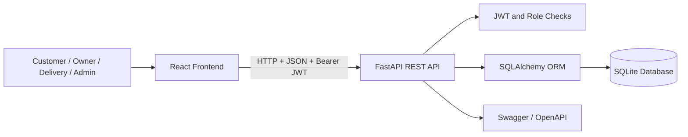

# Project Report: MealMate
## Online Food Ordering & Restaurant Management System

**Project type:** Full-stack web application  
**Technology:** React, FastAPI, SQLite, SQLAlchemy, JWT, Postman, Docker

## 1. Introduction

MealMate is a web-based platform for ordering food from restaurants. Customers can view restaurants and menus, place an order, make a simulated payment and follow the order status. Restaurant owners manage menu items and process incoming orders. Delivery partners update delivery progress, while an administrator monitors platform activity and assigns delivery partners.

## 2. Problem Statement

In a manual food-ordering process, customers may need to contact restaurants directly, restaurant staff may record orders separately, and delivery updates may not be visible to customers. MealMate brings these activities into one platform and stores the related information in a central relational database.

## 3. Objectives

1. Provide a responsive interface for customers to browse restaurants and order food.
2. Allow restaurant owners to manage menu availability and incoming orders.
3. Allow delivery partners to view assigned orders and update delivery status.
4. Give administrators a view of users, orders and delivery assignment.
5. Protect role-specific operations using JWT authentication and authorization.
6. Maintain structured data using normalized relational tables.
7. Provide API documentation, API test requests and automated tests.

## 4. User Roles and Modules

### Customer
- Register and sign in.
- Search and browse restaurants and available menu items.
- Add food to the basket and change quantities.
- Place orders with a delivery address.
- Complete mock payment.
- View order history and order status.
- Submit a rating and review after delivery.

### Restaurant Owner
- View the linked restaurant profile.
- Add menu items and mark dishes as available/unavailable.
- View incoming orders.
- Accept orders, start preparation or cancel an order.

### Delivery Partner
- View orders assigned by the administrator.
- Mark an eligible order as out for delivery.
- Mark an order as delivered.
- View completed deliveries in delivery history.

### Admin
- View platform counts for users, customers, restaurants and orders.
- View the user directory and filter by role.
- View all orders.
- Assign a delivery partner to an order.

## 5. Technology Stack

| Layer | Technology | Use |
|---|---|---|
| Frontend | React | Reusable UI components and role-specific dashboards |
| Styling | CSS | Responsive layout for desktop and mobile |
| Backend | FastAPI | REST endpoints, validation and automatic OpenAPI docs |
| ORM | SQLAlchemy | Database models and queries |
| Database | SQLite | Relational data storage for the MVP |
| Authentication | JWT (HS256) | Signed access tokens and role-based route protection |
| API testing | Postman | Manual request testing by role |
| Automated testing | pytest + FastAPI TestClient | Endpoint and workflow tests |
| Containerization | Docker Compose | Run frontend and backend services together |

## 6. System Architecture

The React client sends HTTP requests to the FastAPI backend. The backend validates request data, verifies the JWT for protected routes, checks the user's role and interacts with SQLite through SQLAlchemy. The API returns JSON responses to the client. FastAPI also exposes interactive Swagger documentation at `/docs`.

## 7. Database Design

The database contains six main tables: `users`, `restaurants`, `menu_items`, `orders`, `order_items` and `reviews`. Primary keys identify records and foreign keys represent relationships. Menu data and order data are kept in separate tables. The `order_items` table stores the item name and unit price at the time of purchase, so older orders remain accurate even if a menu is later edited.

The detailed ER diagram is in `docs/ER_DIAGRAM.md`; table definitions and normalization notes are in `docs/DATABASE_SCHEMA.md`.

## 8. Authentication and Authorization

When a user signs in, the backend verifies the stored password hash and returns a signed JWT. Protected requests send the token in the `Authorization: Bearer <token>` header. The backend verifies the signature and expiry, loads the account and checks the role before running a protected operation. Customer registration creates customer accounts; the four predefined demo accounts are provided to test all roles locally.

Passwords are stored as PBKDF2-HMAC-SHA256 hashes with random salts, not as plain text. The demo JWT secret is only for local development and must be replaced before deployment.

## 9. Order Workflow

1. A customer selects a restaurant and adds available menu items to the basket.
2. The customer submits the order and delivery address. The order starts in `pending` status.
3. The restaurant owner accepts it (`confirmed`) and starts preparation (`preparing`).
4. The admin assigns a delivery partner.
5. The delivery partner changes the status to `out_for_delivery` and later to `delivered`.
6. The customer can submit a rating and review after delivery.

The payment route is a mock flow: it marks the order's payment status as `paid` for demonstration. It does not collect money or connect to a payment provider.

## 10. Validation, Error Handling and Logging

- Pydantic schemas validate names, email format, quantities, prices, rating values and other request fields.
- Role checks prevent users from accessing another role's protected functionality.
- The API returns useful HTTP status codes for common errors such as invalid login, missing records, duplicate accounts and unauthorized access.
- A request middleware records the HTTP method, endpoint, response status and elapsed time.
- Unexpected server errors are logged and return a generic error message to the client.

## 11. Search, Sorting and Pagination

Restaurant browsing supports a text query and pagination. Menu browsing supports dish/category search and pagination. Admin and role-specific order/user lists also accept page and page-size parameters. Restaurant results can be sorted alphabetically or by newest first.

## 12. Testing

The pytest suite covers:
- API health check.
- Public restaurant browsing.
- Customer order creation and mock payment.
- Role-based access denial for a customer attempting to open an admin endpoint.
- Restaurant-owner access to the owner's restaurant.
- End-to-end order status flow across customer, owner, admin and delivery partner roles, including a post-delivery review.

Run from the `backend` directory with `python -m pytest -q`.

## 13. Deployment

Dockerfiles are provided for the backend and frontend. `docker-compose.yml` builds both services, exposes the frontend on port 8080 and backend on port 8000, and stores the SQLite database in a Docker named volume. A real deployment URL must be added only after the services are deployed and verified on a hosting provider.

## 14. Limitations and Future Enhancements

- Replace mock payment with a verified payment-provider integration.
- Use PostgreSQL and database migration tooling for a larger deployment.
- Add email/phone OTP verification and password reset.
- Add live location tracking and notifications for delivery updates.
- Add restaurant analytics, coupon support and richer review summaries.
- Add additional test coverage, rate limiting, HTTPS and production monitoring.

## 15. Conclusion

MealMate demonstrates the main workflow of an online food ordering platform through four role-based modules. It combines a responsive React interface with a REST API, JWT protection and a normalized relational database. The project also includes API documentation, Postman requests, automated tests and Docker configuration, providing a base that can be extended further.

## 16. Verification Notes to Complete Before Submission

After running the project on your own machine, add your own brief observations here:

- Environment used:
- Customer journey tested:
- Owner and delivery flows tested:
- Any bug found and fixed:
- One improvement you would build next:
