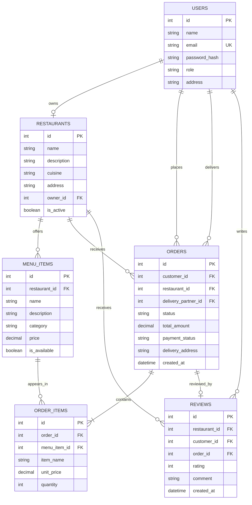

# Entity Relationship Diagram

## Relationship notes

- One owner manages one restaurant in this MVP; one restaurant has many menu items.
- A customer can place many orders. Each order belongs to one restaurant and can be assigned to one delivery partner.
- An order contains one or more order-item rows. `item_name` and `unit_price` are snapshots so an old order remains readable if the restaurant later edits its menu.
- A customer can submit at most one review for a delivered order.
- The `role` column distinguishes customer, owner, delivery and admin accounts.
